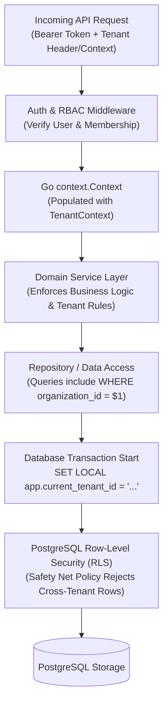

# WorkSphere Multi-Tenancy Architecture

## 1. Multi-Tenancy Model

WorkSphere employs a **Shared Database, Shared Schema** multi-tenancy model. Every organization (tenant) shares the same PostgreSQL database and schema definitions. Data isolation is enforced systematically across the application runtime and data tier.

### Rationale
- **Resource Efficiency**: Significantly lower operational and infrastructure overhead compared to database-per-tenant or schema-per-tenant architectures on AWS RDS.
- **Simplified Migrations**: Migrations run once per deployment across all tenants rather than looping over hundreds of isolated schemas.
- **Operational Scalability**: Connection pooling (via PgBouncer/RDS Proxy) is streamlined, avoiding database connection exhaustion.

---

## 2. Multi-Tenant Tenancy Invariants

1. **Every Organization-Owned Table Has `organization_id`**:
   Every table representing tenant-owned business data (e.g. `users`, `projects`, `tasks`, `invoices`, `timesheets`) MUST have an `organization_id UUID NOT NULL` column.
2. **Composite Primary Keys and Foreign Keys**:
   Where practical, foreign key constraints incorporate `organization_id` (e.g., `FOREIGN KEY (organization_id, project_id) REFERENCES projects(organization_id, id)`). This guarantees referential integrity within tenant boundaries and physically prevents cross-tenant entity relationships.
3. **Deterministic Tenant Context**:
   The backend API runtime extracts the tenant context from the verified user session/claims and sets the PostgreSQL runtime configuration variable `app.current_tenant_id` at the initiation of each database transaction.

---

## 3. Defense-in-Depth Isolation Layers



### Layer 1: Application Authorization Middleware
- Incoming requests must supply authentication tokens. The authorization middleware verifies that the user is an active member of the requested `organization_id` with appropriate role permissions.

### Layer 2: Explicit SQL Query Scoping (`sqlc`)
- In standard application queries, `WHERE organization_id = $1` is explicitly compiled into every query generated by `sqlc`. The service layer passes `organization_id` extracted from the authenticated `context.Context`.

### Layer 3: PostgreSQL Row-Level Security (RLS) as a Safety Net
- Every tenant table has Row-Level Security enabled:
  ```sql
  ALTER TABLE projects ENABLE ROW LEVEL SECURITY;
  ALTER TABLE projects FORCE ROW LEVEL SECURITY;

  CREATE POLICY tenant_isolation_policy ON projects
    FOR ALL
    TO application_role
    USING (organization_id = NULLIF(current_setting('app.current_tenant_id', true), '')::uuid);
  ```
- Before executing operations inside a transaction, the connection pool sets the current tenant:
  ```go
  _, err := tx.Exec(ctx, "SET LOCAL app.current_tenant_id = $1", tenantID)
  ```
- `SET LOCAL` ensures the variable is scoped strictly to the current transaction and automatically resets when the connection returns to the connection pool.

---

## 4. Cross-Tenant Testing Requirements

Any pull request introducing tenant-owned data models or services must include cross-tenant access test suites verifying:
1. User from Organization A cannot read records belonging to Organization B.
2. User from Organization A cannot update or delete records belonging to Organization B (must yield HTTP 404 or 403, never successful execution).
3. Attempting to insert a child record (e.g. Task) referencing a parent entity (e.g. Project) from another tenant fails database constraints.
4. Database queries run without `app.current_tenant_id` set cannot read any rows when executed under `application_role`.
