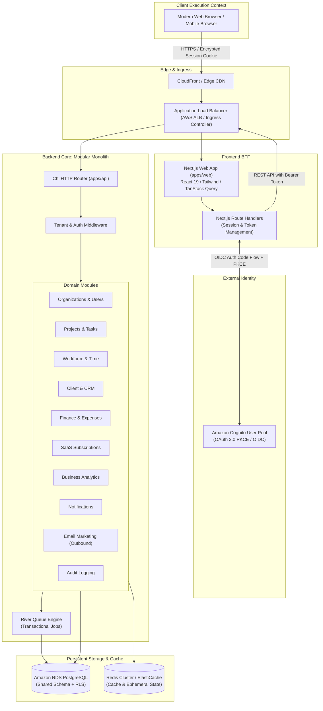

# WorkSphere Architecture Overview

## 1. Executive Summary

**WorkSphere** is a modern, Sri Lanka-first, subscription-based, multi-tenant business operations SaaS platform. It consolidates business operations across organization management, workforce and time tracking, projects, CRM, billing, finance, analytics, notifications, and client communications into a unified, secure platform.

WorkSphere is architected as a **Modular Monolith** designed for high developer productivity, clear domain boundaries, cost-efficient deployment, and straightforward operation during early growth, while retaining clean architectural seams that allow individual domains to be extracted into distributed services if scale necessitates.

---

## 2. Architectural Principles

1. **Modular Monolith First**:
   All core business modules reside within a single backend codebase and run within a single operational deployable unit (`apps/api`), sharing foundational infrastructure (PostgreSQL, Redis). Business logic is strictly encapsulated inside domain packages under `internal/`. Cross-domain calls must occur through well-defined service interfaces or asynchronous domain events.

2. **Strict Multi-Tenant Isolation**:
   WorkSphere implements a **shared-database, shared-schema** multi-tenancy model. Every organization-scoped record is anchored to `organization_id`. Database security combines transactional tenant context setting with PostgreSQL Row-Level Security (RLS) and strict application-level authorization gates.

3. **Decoupled Identity and Authorization**:
   Authentication delegates to an external OpenID Connect (OIDC) identity provider (Amazon Cognito User Pools proposed). WorkSphere maintains its own internal authorization engine, tenancy mapping, roles, and granular permissions linked via the provider's stable subject identifier (`sub`).

4. **BFF (Backend-For-Frontend) and Server-Managed Sessions**:
   The frontend (`apps/web`) leverages Next.js App Router acting as a secure BFF. Session cookies are strictly `HttpOnly`, `SameSite=Lax`, and `Secure`. Sensitive access and refresh tokens are stored server-side and never exposed to the client-side JavaScript execution context.

5. **Asynchronous Background Processing**:
   Heavy or deferred workloads (outbound email delivery, scheduled reminders, report generation, audit log persistence) are offloaded to **River** (PostgreSQL-backed transactional queue) and **Redis** cache/pub-sub, ensuring atomic database transactions without dual-write inconsistencies.

6. **Sri Lanka-First Localization Defaults**:
   The platform defaults to Sri Lankan business conventions (LKR currency, Asia/Colombo timezone, `en-LK` locale, DD/MM/YYYY date formatting, +94 telephone parsing) while maintaining standard UTC database storage and strict `NUMERIC` precision for all financial accounting.

---

## 3. High-Level System Architecture

---

## 4. Module Directory Mapping

| Module Name | Backend Package | Responsibility |
| :--- | :--- | :--- |
| **Organization & Users** | `internal/organizations`, `internal/identity` | Workspace creation, employee management, departments, profiles. |
| **Authorization** | `internal/authorization` | RBAC/ABAC engine, permission verification, tenant membership. |
| **Project & Task** | `internal/projects`, `internal/tasks` | Work tracking, Kanban boards, priorities, deadlines, dependencies. |
| **Workforce & Time** | `internal/workforce`, `internal/leave` | Clock-in/out, attendance records, timesheets, leave approvals. |
| **Client & CRM** | `internal/crm` | Client accounts, contacts, sales pipeline, communication log. |
| **Finance & Expenses** | `internal/finance` | Invoices, expenses, project budgets, profitability, LKR accounting. |
| **Business Analytics** | `internal/analytics` (or within finance/workforce) | Aggregated KPIs, utilization rates, executive dashboards. |
| **Notifications** | `internal/notifications` | In-app alerts, activity feeds, automated reminders. |
| **SaaS Subscriptions** | `internal/billing` | Tenant plans, payment gateway integration, usage quotas. |
| **Email Marketing** | `internal/email` | Outbound campaigns, contact lists, templates, unsubscribe suppression. |
| **Audit Trail** | `internal/audit` | Immutable audit logs for compliance and operational tracking. |

---

## 5. Technology Stack Summary

- **Frontend**: Next.js (App Router), TypeScript, Tailwind CSS, shadcn/ui component architecture, TanStack Query, Zod.
- **Backend**: Go (1.23+), Chi router, `pgx/v5` PostgreSQL driver, `sqlc` type-safe SQL code generation, `goose` database migrations.
- **Background Jobs**: River (PostgreSQL transactional queues) & Redis.
- **Data Tier**: PostgreSQL 16+ with Row-Level Security, Redis 7+.
- **DevOps & Infrastructure**: Docker, Docker Compose, Kubernetes, Helm, Argo CD, Terraform, Ansible, AWS.
- **Observability**: Prometheus, Grafana, Loki, OpenTelemetry instrumentation.
